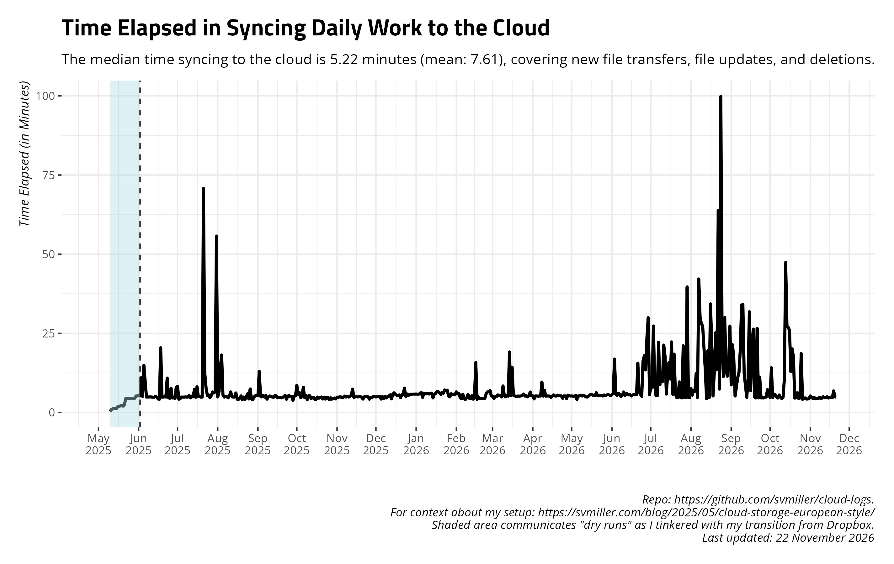
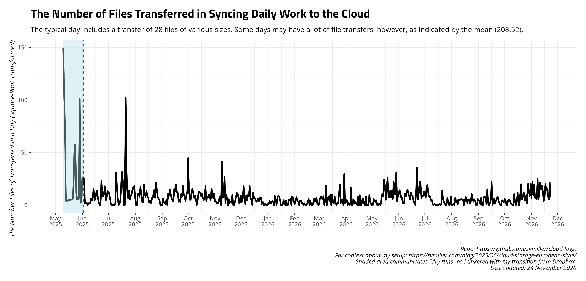

# A Summary of Daily Cloud Syncs

This is a silly project of mine to track/automate my daily work activity
and syncs to my cloud storage. You can [read a bit more about my setup
here](https://svmiller.com/blog/2025/05/cloud-storage-european-style/).
Every day, I sync my main cloud storage to a backup cloud provider and
log the files transferred, the total size of files transferred, and the
time elapsed to sync my main cloud storage provider to my backup. This
script and repository gathers the last two measures and formats them for
presentation. I have an automated procedure that does this every morning
and uploads to Github.

## Time Elapsed Syncing to Cloud, Daily

## Total Size of Files Transferred, Daily

## Total Number of Files Transferred, Daily

## Summary of Past 14 Days

    #> # A tibble: 14 × 4
    #>    date       ftransfer stransfer   elapsed
    #>    <date>         <dbl> <chr>       <chr>  
    #>  1 2026-11-04       380 74.847 MiB  4m46.3s
    #>  2 2026-11-05        57 3.487 MiB   4m20.8s
    #>  3 2026-11-06        45 1.664 MiB   4m24.8s
    #>  4 2026-11-07        30 74.959 KiB  4m21.4s
    #>  5 2026-11-08       632 13.017 MiB  4m48.5s
    #>  6 2026-11-09        34 136.311 KiB 4m24.1s
    #>  7 2026-11-10       112 2.557 MiB   4m32.5s
    #>  8 2026-11-11       468 5.815 MiB   4m58.3s
    #>  9 2026-11-12       216 4.728 MiB   4m39.3s
    #> 10 2026-11-13       335 8.642 MiB   4m40.1s
    #> 11 2026-11-14       185 2.590 MiB   4m58.3s
    #> 12 2026-11-15        14 25.928 KiB  4m33.2s
    #> 13 2026-11-16        38 374.343 KiB 4m45.9s
    #> 14 2026-11-17       412 4.001 MiB   4m51.4s
